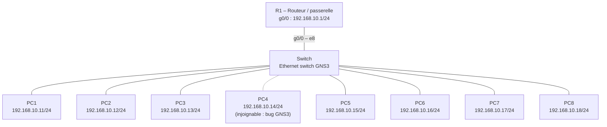

# Projet 1 — Câblage et adressage IP d'un petit bureau

## 1. Objectif

Câbler et adresser le réseau d'un petit bureau dans GNS3 : 8 postes reliés à un switch, et un routeur R1 qui sert de passerelle. Puis vérifier que tous les postes communiquent entre eux et avec la passerelle.

## 2. Étape 1 : schéma du réseau

### 2.1 Topologie dans GNS3

### 2.2 Schéma annoté

## 3. Étape 2 : plan d'adressage IP

| Paramètre | Valeur |
|---|---|
| Réseau | 192.168.10.0/24 |
| Masque | 255.255.255.0 |
| Passerelle | 192.168.10.1 (R1, g0/0) |

| Équipement | Interface | Adresse IP | Masque | Passerelle |
|---|---|---|---|---|
| R1 | g0/0 | 192.168.10.1 | 255.255.255.0 | n/a |
| PC1 | e0 | 192.168.10.11 | 255.255.255.0 | 192.168.10.1 |
| PC2 | e0 | 192.168.10.12 | 255.255.255.0 | 192.168.10.1 |
| PC3 | e0 | 192.168.10.13 | 255.255.255.0 | 192.168.10.1 |
| PC4 | e0 | 192.168.10.14 | 255.255.255.0 | 192.168.10.1 |
| PC5 | e0 | 192.168.10.15 | 255.255.255.0 | 192.168.10.1 |
| PC6 | e0 | 192.168.10.16 | 255.255.255.0 | 192.168.10.1 |
| PC7 | e0 | 192.168.10.17 | 255.255.255.0 | 192.168.10.1 |
| PC8 | e0 | 192.168.10.18 | 255.255.255.0 | 192.168.10.1 |

## 4. Étape 3 : câblage

| Liaison | Port source | Port destination | Câble |
|---|---|---|---|
| PC1 à PC8 → Switch | e0 de chaque PC | ports e0 à e7 du switch | Ethernet droit |
| Switch → R1 | e8 | g0/0 | Ethernet droit |

**Légende :**

- Réseau du bureau : `192.168.10.0/24`, passerelle `192.168.10.1`.
- Postes : PC1 à PC8 en IP statique, de `192.168.10.11` à `192.168.10.18`.
- Trait pointillé : liaison touchée par le bug de GNS3 (voir partie 7).

## 5. Étape 4 : configuration des PC et du routeur

Chaque poste reçoit son adresse IP, son masque et sa passerelle, et l'interface `g0/0` du routeur R1 est configurée en `192.168.10.1/24`.

## 6. Test et résultat

Je teste la connectivité avec des pings entre les postes et vers la passerelle.

| Test | Résultat |
|---|---|
| PC1, PC2, PC3, PC5, PC6, PC7, PC8 vers la passerelle et entre eux | ✅ |
| Tous les postes vers PC4 | ❌ Injoignable (bug GNS3) |
| PC4 vers les autres postes et la passerelle | ❌ Injoignable (bug GNS3) |

## 7. Difficultés rencontrées

> ⚠️ PC4 n'a pas pu être pingué par les autres postes, ni joindre le routeur R1, à cause d'un bug de GNS3.

**Symptômes observés :**

- Depuis PC1, `ping 192.168.10.14` répond `host (192.168.10.14) not reachable`.
- PC4 ne parvient pas à joindre la passerelle `192.168.10.1`.
- Les autres postes communiquent normalement entre eux et avec le routeur.

**Vérifications effectuées :**

- Adressage de PC4 contrôlé avec `show ip` (`192.168.10.14/24`, passerelle `192.168.10.1`).
- Câble de PC4 vérifié dans GNS3.
- Redémarrage de PC4, puis de l'application GNS3.

Le problème est resté malgré ces manipulations. L'adressage et la configuration de PC4 sont corrects : la panne vient du simulateur, pas du plan d'adressage ni de la configuration.

Ping de PC1 vers `192.168.10.14` :

## 8. Conclusion

Le réseau du bureau est câblé et adressé dans le réseau `192.168.10.0/24`, avec R1 comme passerelle. Tous les postes communiquent entre eux et avec la passerelle, sauf PC4, bloqué par un bug de GNS3 alors que sa configuration est correcte.
