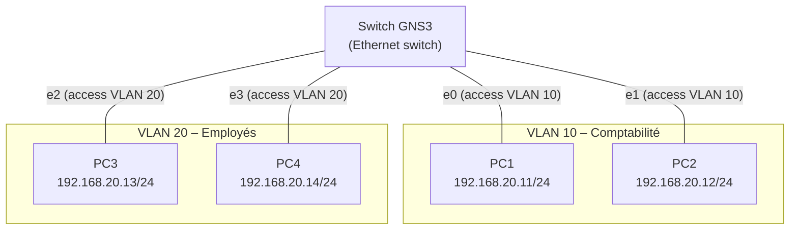

# Projet 2 — Segmentation en VLAN d'un réseau d'entreprise

1. Configuration des PC : 


2. Test avant les VLAN 


3. Test apres les VLAN


## Documentation de la configuration VLAN

### 1. Principe

Un **VLAN** (Virtual LAN) découpe un switch en plusieurs réseaux logiques séparés. Deux postes branchés sur le même switch mais dans des VLAN différents ne peuvent pas communiquer entre eux, comme s'ils étaient sur deux switches distincts. Ici, le service **Comptabilité** est isolé des **autres employés** pour des raisons de sécurité.

### 2. Plan des VLAN

| VLAN | Nom | Rôle |
|---|---|---|
| 10 | Comptabilité | Postes du service comptabilité |
| 20 | Employés | Postes des autres employés |

### 3. Plan d'adressage IP

Tous les postes sont dans le même sous-réseau : `192.168.20.0/24` (masque `255.255.255.0`). Cela prouve que le blocage vient bien des VLAN et non d'un changement de réseau IP.

| Poste | VLAN | Adresse IP | Masque | Port du switch |
|---|---|---|---|---|
| PC1 | 10 – Comptabilité | 192.168.20.11 | 255.255.255.0 | e0 |
| PC2 | 10 – Comptabilité | 192.168.20.12 | 255.255.255.0 | e1 |
| PC3 | 20 – Employés | 192.168.20.13 | 255.255.255.0 | e2 |
| PC4 | 20 – Employés | 192.168.20.14 | 255.255.255.0 | e3 |

### 4. Schéma du réseau



### 5. Configuration du switch

Le switch utilisé est l'**Ethernet switch** intégré à GNS3, configuré dans *Configure → Switch configuration*. Chaque port est en mode **access** : il appartient à un seul VLAN, et le poste branché n'a pas besoin de le savoir.

| Port | VLAN | Type | Poste relié |
|---|---|---|---|
| 0 | 10 | access | PC1 |
| 1 | 10 | access | PC2 |
| 2 | 20 | access | PC3 |
| 3 | 20 | access | PC4 |

Configuration des postes (exemple pour PC1) :

```
ip 192.168.20.11 255.255.255.0
save
show ip
```

### 6. Tests de connectivité

**Avant la configuration des VLAN** : tous les ports sont dans le VLAN 1 par défaut, et tous les postes se joignent entre eux.

**Après la configuration des VLAN** :

| Depuis | Vers | Même VLAN ? | Résultat attendu | Résultat obtenu |
|---|---|---|---|---|
| PC1 | PC2 | Oui (10) | ✅ Répond | ✅ |
| PC3 | PC4 | Oui (20) | ✅ Répond | ✅ |
| PC1 | PC3 | Non (10 → 20) | ❌ Injoignable | ❌ |
| PC1 | PC4 | Non (10 → 20) | ❌ Injoignable | ❌ |
| PC2 | PC3 | Non (10 → 20) | ❌ Injoignable | ❌ |
| PC3 | PC1 | Non (20 → 10) | ❌ Injoignable | ❌ |

Quand le ping échoue, la console VPCS affiche `host (192.168.20.xx) not reachable`. Le poste ne reçoit aucune réponse ARP, car le switch ne transmet pas le trafic d'un VLAN vers l'autre.

### 7. Analyse

- **Étanchéité confirmée :** les postes de la comptabilité (VLAN 10) ne peuvent joindre aucun poste des autres employés (VLAN 20), et inversement, bien qu'ils aient des adresses IP du même sous-réseau.
- **Communication interne conservée :** les postes d'un même VLAN communiquent normalement entre eux.
- **Limite :** sans routeur, aucun échange n'est possible entre VLAN. Pour autoriser certains flux (par exemple un accès à une imprimante partagée), il faudrait un routeur ou un switch de niveau 3 (routage inter-VLAN), avec des règles de filtrage pour garder la comptabilité protégée.

### 8. Conclusion

La segmentation en deux VLAN répond au besoin de l'entreprise : le trafic de la comptabilité est séparé de celui des autres employés, sans matériel supplémentaire. La configuration est simple (une affectation de port par poste) et se vérifie facilement par des tests de ping.
