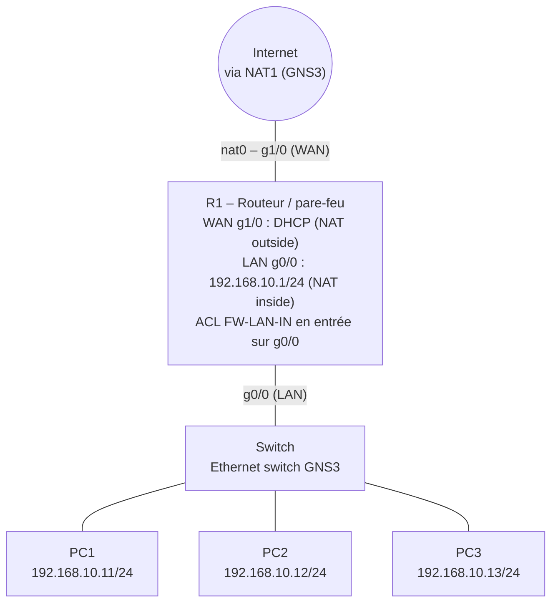

# Projet 3 — Mise en place d'un routeur/pare-feu pour une petite entreprise

1. Configuration interface WAN et LAN


2. Activation du NAT


3. Configuration des PC


4. Test d'acces a internet 


5. Règle du Par-feu 


6. Ping apres le Par-feu 


## 7. Documentation

### 7.1 Plan d'adressage

| Paramètre | Valeur |
|---|---|
| Réseau local (LAN) | 192.168.10.0/24 |
| Masque | 255.255.255.0 |
| Passerelle des postes | 192.168.10.1 (R1, g0/0) |
| DNS utilisé par les postes | 8.8.8.8 |

| Équipement | Interface | Adresse IP | Rôle |
|---|---|---|---|
| R1 | g0/0 | 192.168.10.1/24 | LAN (NAT inside, pare-feu en entrée) |
| R1 | g1/0 | DHCP (via NAT1) | WAN (NAT outside) |
| PC1 | e0 | 192.168.10.11/24 | Poste du LAN |
| PC2 | e0 | 192.168.10.12/24 | Poste du LAN |
| PC3 | e0 | 192.168.10.13/24 | Poste du LAN |

### 7.2 Schéma du réseau



### 7.3 Configuration du routeur R1

**Interfaces WAN et LAN :**

```
interface GigabitEthernet0/0
 description LAN
 ip address 192.168.10.1 255.255.255.0
 no shutdown
 exit
interface GigabitEthernet1/0
 description WAN
 ip address dhcp
 no shutdown
 exit
```

**NAT (accès Internet pour tout le LAN) :**

```
interface GigabitEthernet0/0
 ip nat inside
 exit
interface GigabitEthernet1/0
 ip nat outside
 exit
access-list 1 permit 192.168.10.0 0.0.0.255
ip nat inside source list 1 interface GigabitEthernet1/0 overload
ip name-server 8.8.8.8
```

**Pare-feu (liste d'accès étendue appliquée sur le LAN) :**

```
ip access-list extended FW-LAN-IN
 remark Bloquer le DNS vers l'exterieur
 deny udp 192.168.10.0 0.0.0.255 any eq 53
 deny tcp 192.168.10.0 0.0.0.255 any eq 53
 remark Autoriser le reste du trafic
 permit ip any any
 exit
interface GigabitEthernet0/0
 ip access-group FW-LAN-IN in
```

Configuration sauvegardée avec `write memory`.

### 7.4 Règles de pare-feu

La liste `FW-LAN-IN` est appliquée sur l'interface `g0/0` dans le sens **entrant** : elle filtre le trafic envoyé par les postes du LAN vers le routeur, donc vers Internet.

| N° | Action | Protocole | Source | Destination | Port | Objectif |
|---|---|---|---|---|---|---|
| 10 | **deny** | UDP | 192.168.10.0/24 | any | 53 (DNS) | Bloquer la résolution de noms vers l'extérieur |
| 20 | **deny** | TCP | 192.168.10.0/24 | any | 53 (DNS) | Bloquer le DNS en TCP |
| 30 | **permit** | IP | any | any | tous | Autoriser tout le reste du trafic |

**Remarques :**

- Les règles sont lues **dans l'ordre** : la première qui correspond s'applique. La règle `permit ip any any` doit donc rester **en dernier**, sinon tout le trafic serait bloqué.
- Le nom de service Cisco `domain` correspond au port 53.

### 7.5 Tests

| Test | Commande (depuis PC1) | Résultat attendu | Résultat obtenu |
|---|---|---|---|
| Accès à Internet par IP, avant la règle | `ping 8.8.8.8` | ✅ Répond | ✅ |
| Accès à Internet par nom, avant la règle | `ping google.com` | ✅ Nom résolu, répond | ✅ |
| Accès par IP, après la règle (autorisé) | `ping 8.8.8.8` | ✅ Répond | ✅ |
| Accès par nom, après la règle (bloqué) | `ping google.com` | ❌ Nom non résolu | ❌ |
| Compteurs de la règle | `show access-lists` | `matches` sur les lignes `deny ... eq domain` | ✅ |

### 7.6 Analyse

- **Accès autorisé :** le trafic non filtré (par exemple le ping vers `8.8.8.8`) passe par le routeur et est traduit par le NAT. Les postes du LAN partagent l'adresse WAN de R1.
- **Trafic bloqué :** les requêtes DNS (port 53) sont refusées par la règle `deny`. Le poste ne peut plus résoudre `google.com`, alors que l'accès par adresse IP fonctionne toujours. Cela prouve que seul le service visé est bloqué.
- **Preuve côté routeur :** le compteur `matches` de la commande `show access-lists` augmente à chaque requête bloquée.
- **Limites :** cette liste d'accès est un filtrage simple. Un vrai pare-feu appliquerait une politique par défaut plus stricte (tout interdire sauf ce qui est autorisé) et un suivi de connexions. Le principe reste le même : une règle précise, appliquée sur une interface, dans un sens donné.

### 7.7 Conclusion

Le routeur R1 relie le réseau local à Internet : l'interface WAN récupère son adresse en DHCP, l'interface LAN sert de passerelle, et le NAT permet à tous les postes de sortir. Un pare-feu basique, sous forme de liste d'accès, bloque le DNS vers l'extérieur et laisse passer le reste du trafic. Les tests confirment les deux comportements : le trafic autorisé fonctionne et le trafic bloqué est refusé.
