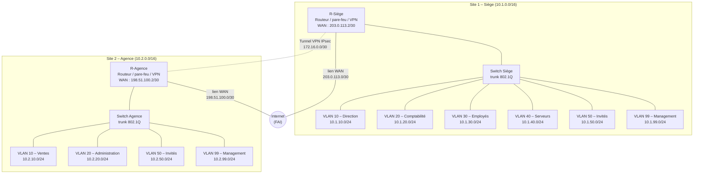

# Projet 5 — Conception réseau complète pour une PME multi-sites

## 1. Recueil des besoins

### 1.1 Présentation de l'entreprise

La PME compte **33 utilisateurs** répartis sur **2 sites distants** :

- **Siège** : site principal, 23 utilisateurs et les serveurs de l'entreprise.
- **Agence** : site secondaire, 10 utilisateurs.

Les deux sites doivent partager les mêmes ressources (fichiers, annuaire) et communiquer de façon sécurisée.

### 1.2 Équipements par site

| Site | Service | Postes | Autres équipements |
|---|---|---|---|
| Siège | Direction | 3 | n/a |
| Siège | Comptabilité | 5 | n/a |
| Siège | Employés | 15 | 2 imprimantes réseau |
| Siège | Serveurs | n/a | 2 serveurs (AD/DNS/DHCP et fichiers) |
| Siège | Wi-Fi invités | n/a | environ 10 appareils en même temps |
| Siège | **Total** | **23 postes** | 2 imprimantes, 2 serveurs, 1 point d'accès Wi-Fi |
| Agence | Ventes | 7 | n/a |
| Agence | Administration | 3 | 1 imprimante réseau |
| Agence | Wi-Fi invités | n/a | environ 5 appareils en même temps |
| Agence | **Total** | **10 postes** | 1 imprimante, 1 point d'accès Wi-Fi |

### 1.3 Services partagés

| Service | Hébergement | Utilisateurs concernés |
|---|---|---|
| Annuaire et authentification (AD) | Serveur du Siège | Les 2 sites |
| DNS et DHCP | Serveur du Siège | Les 2 sites |
| Partage de fichiers | Serveur du Siège | Les 2 sites |
| Impression | Imprimantes de chaque site | Utilisateurs du site |
| Accès Internet | Routeur de chaque site | Tous les utilisateurs |
| Wi-Fi invités | Point d'accès de chaque site | Visiteurs |

### 1.4 Besoins de sécurité

- Les données de la **comptabilité** ne doivent être accessibles qu'à la comptabilité et à la direction.
- Les **invités** accèdent à Internet uniquement, sans accès au réseau interne.
- Le trafic entre les deux sites doit être **chiffré**.
- L'administration des équipements réseau est réservée à un **poste d'administration**.

### 1.5 Besoins de performance et de disponibilité

| Besoin | Valeur retenue |
|---|---|
| Débit Internet Siège | 100 Mbit/s |
| Débit Internet Agence | 50 Mbit/s |
| Débit minimal du VPN entre les sites | 20 Mbit/s |
| Heures d'utilisation | du lundi au vendredi, de 8 h à 18 h |
| Interruption tolérée | jusqu'à 4 h en cas de panne |
| Sauvegarde des données | quotidienne, avec copie externe |

### 1.6 Croissance prévue

Une augmentation d'environ **30 % des effectifs sur 3 ans** est prévue : environ 30 utilisateurs au Siège et 13 à l'Agence. Chaque réseau est un `/24` (254 adresses), ce qui laisse une large marge. Il faudrait revoir le plan d'adressage si un site dépassait 200 postes.

### 1.7 Contraintes

- Budget limité (PME) : le matériel existant et les abonnements Internet actuels sont réutilisés.
- Mise en place rapide et administration simple, sans équipe réseau dédiée.
- Évolutivité : possibilité d'ajouter un 3e site plus tard.

### 1.8 Hypothèses

Ces chiffres sont des **hypothèses de travail** retenues pour concevoir l'architecture. Ils représentent une PME typique et pourront être ajustés si les besoins réels changent.

---

## 2. Architecture retenue

**Principe :** chaque site possède un routeur-pare-feu qui assure le routage entre VLAN, le NAT vers Internet et le VPN. Un tunnel IPsec chiffré relie les deux routeurs à travers Internet : les deux sites se voient comme un seul réseau d'entreprise.

---

## 3. Plan d'adressage global

### 3.1 Principe

- Plage privée `10.0.0.0/8` (RFC 1918), découpée **par site** : `10.1.0.0/16` pour le Siège et `10.2.0.0/16` pour l'Agence.
- Le **3e octet correspond au numéro de VLAN** (VLAN 10 → `x.x.10.0/24`). Cela rend l'adressage lisible et facile à dépanner.
- Chaque réseau est un `/24` (254 adresses), ce qui laisse une large marge de croissance.
- Conventions dans chaque réseau :

| Plage | Usage |
|---|---|
| .1 | Passerelle (routeur) |
| .2 à .9 | Équipements réseau |
| .10 à .99 | Serveurs et imprimantes (IP statiques) |
| .100 à .199 | Pool DHCP des postes |
| .200 à .254 | Réserve |

### 3.2 Site 1 – Siège

| VLAN | Nom | Réseau | Passerelle | Pool DHCP | Équipements prévus |
|---|---|---|---|---|---|
| 10 | Direction | 10.1.10.0/24 | 10.1.10.1 | 10.1.10.100–199 | 3 postes |
| 20 | Comptabilité | 10.1.20.0/24 | 10.1.20.1 | 10.1.20.100–199 | 5 postes |
| 30 | Employés | 10.1.30.0/24 | 10.1.30.1 | 10.1.30.100–199 | 15 postes + 2 imprimantes |
| 40 | Serveurs | 10.1.40.0/24 | 10.1.40.1 | aucun (statique) | 2 serveurs |
| 50 | Invités | 10.1.50.0/24 | 10.1.50.1 | 10.1.50.100–199 | environ 10 appareils |
| 99 | Management | 10.1.99.0/24 | 10.1.99.1 | aucun (statique) | équipements réseau |

### 3.3 Site 2 – Agence

| VLAN | Nom | Réseau | Passerelle | Pool DHCP | Équipements prévus |
|---|---|---|---|---|---|
| 10 | Ventes | 10.2.10.0/24 | 10.2.10.1 | 10.2.10.100–199 | 7 postes |
| 20 | Administration | 10.2.20.0/24 | 10.2.20.1 | 10.2.20.100–199 | 3 postes + 1 imprimante |
| 50 | Invités | 10.2.50.0/24 | 10.2.50.1 | 10.2.50.100–199 | environ 5 appareils |
| 99 | Management | 10.2.99.0/24 | 10.2.99.1 | aucun (statique) | équipements réseau |

### 3.4 Liens WAN et tunnel

| Lien | Réseau | Côté Siège | Côté Agence / FAI |
|---|---|---|---|
| Siège ↔ FAI | 203.0.113.0/30 | R-Siège : 203.0.113.2 | FAI : 203.0.113.1 |
| Agence ↔ FAI | 198.51.100.0/30 | FAI : 198.51.100.1 | R-Agence : 198.51.100.2 |
| Tunnel VPN IPsec | 172.16.0.0/30 | R-Siège : 172.16.0.1 | R-Agence : 172.16.0.2 |

Les adresses `203.0.113.0/24` et `198.51.100.0/24` sont des plages **réservées à la documentation** (RFC 5737), utilisées pour simuler des adresses publiques.

### 3.5 Adresses fixes principales

| Équipement | Adresse |
|---|---|
| Serveur AD / DNS / DHCP | 10.1.40.10 |
| Serveur de fichiers | 10.1.40.11 |
| Imprimante Siège 1 | 10.1.30.20 |
| Imprimante Siège 2 | 10.1.30.21 |
| Imprimante Agence | 10.2.20.20 |
| Switch Siège (management) | 10.1.99.2 |
| Switch Agence (management) | 10.2.99.2 |

---

## 4. VLAN

### 4.1 Liste des VLAN

| VLAN | Nom | Sites | Rôle |
|---|---|---|---|
| 10 | Direction (Siège) / Ventes (Agence) | Siège, Agence | Utilisateurs principaux du site |
| 20 | Comptabilité (Siège) / Administration (Agence) | Siège, Agence | Données sensibles |
| 30 | Employés | Siège | Bureautique |
| 40 | Serveurs | Siège | Services partagés |
| 50 | Invités | Siège, Agence | Internet uniquement |
| 99 | Management | Siège, Agence | Administration des équipements |

### 4.2 Choix techniques

- **Ports d'accès** (access) pour les postes, **trunk 802.1Q** entre chaque switch et son routeur.
- **Routage inter-VLAN** par le routeur (sous-interfaces 802.1Q, ou « router on a stick »), solution simple et peu coûteuse pour une PME de cette taille.
- **VLAN natif** inutilisé sur les trunks, et **ports inutilisés désactivés**, pour limiter les risques de saut de VLAN.

---

## 5. Interconnexion des sites

### 5.1 Solutions comparées

| Critère | VPN IPsec site-à-site | Ligne dédiée (ligne louée / MPLS) |
|---|---|---|
| Coût | Faible (abonnement Internet existant) | Élevé (abonnement mensuel important) |
| Délai de mise en place | Rapide | Long (installation par l'opérateur) |
| Sécurité | Chiffrement IPsec | Réseau privé de l'opérateur, souvent non chiffré |
| Performance | Dépend d'Internet (débit et latence variables) | Débit et qualité garantis |
| Complexité | Configuration des routeurs | Gérée en grande partie par l'opérateur |
| Évolutivité | Facile (ajout d'un site = nouveau tunnel) | Contrat à renégocier |

### 5.2 Choix : VPN IPsec site-à-site

**Justification :**
- Les besoins sont ceux d'une PME : un coût faible et une mise en œuvre rapide pèsent plus que la qualité de service garantie.
- Les échanges (fichiers, annuaire, impression) tolèrent des débits et une latence variables. Avec 50 Mbit/s à l'Agence, le débit minimal de 20 Mbit/s demandé pour le VPN est largement atteignable.
- Le **chiffrement** protège les données qui traversent Internet.
- Les deux routeurs-pare-feu assurent déjà le NAT et le filtrage : le VPN s'ajoute sans matériel supplémentaire.

**Paramètres prévus du tunnel :**

| Élément | Choix |
|---|---|
| Protocole | IPsec (IKE phase 1 et ESP phase 2) |
| Chiffrement | AES-256 |
| Intégrité | SHA-256 |
| Échange de clés | Diffie-Hellman groupe 14 |
| Authentification | Clé pré-partagée (PSK) forte |
| Adresses du tunnel | 172.16.0.0/30 |

### 5.3 Routage entre les sites

- **Siège :** route vers `10.2.0.0/16` via `172.16.0.2` (tunnel).
- **Agence :** route vers `10.1.0.0/16` via `172.16.0.1` (tunnel).
- Routes **statiques** : suffisantes pour 2 sites. Un protocole comme OSPF serait envisagé si le nombre de sites augmentait.
- Route par défaut vers le FAI sur chaque site, avec NAT overload pour l'accès à Internet.

---

## 6. Sécurité

| Règle | Objectif |
|---|---|
| Invités (VLAN 50) : accès à Internet uniquement, interdits vers les VLAN internes | Protéger le réseau interne |
| Comptabilité (VLAN 20) : accessible seulement depuis la comptabilité et la direction | Protéger les données sensibles |
| Serveurs (VLAN 40) : ports limités aux services nécessaires (DNS, fichiers, annuaire) | Réduire la surface d'attaque |
| Agence : accès limité aux serveurs du Siège, pas à la comptabilité | Limiter le trafic au strict nécessaire |
| Management (VLAN 99) : accessible depuis un poste d'administration uniquement | Protéger les équipements réseau |
| SSH au lieu de Telnet, mots de passe chiffrés sur les équipements | Sécuriser l'administration |
| Ports inutilisés désactivés | Empêcher les branchements non autorisés |

Ces règles sont appliquées par des **listes de contrôle d'accès (ACL)** sur les routeurs-pare-feu.

---

## 7. Services réseau

| Service | Emplacement | Détail |
|---|---|---|
| DHCP | Serveur du Siège (10.1.40.10) | Un pool par VLAN, avec relais DHCP côté Agence |
| DNS | Serveur du Siège | Résolution interne et externe |
| Annuaire (AD) | Serveur du Siège | Authentification des utilisateurs des deux sites |
| Fichiers | Serveur du Siège (10.1.40.11) | Accessible depuis l'Agence par le VPN |
| Sauvegarde | Serveur de fichiers | Sauvegarde quotidienne, avec copie externe |
| Wi-Fi invités | VLAN 50 sur chaque site | Isolé du réseau interne |

---

## 8. Matériel prévu

| Site | Équipement | Quantité | Rôle |
|---|---|---|---|
| Siège | Routeur / pare-feu avec VPN (≥ 100 Mbit/s en chiffrement) | 1 | Routage, NAT, VPN, filtrage |
| Siège | Switch manageable (VLAN, trunk) | 1 | Commutation et VLAN |
| Siège | Point d'accès Wi-Fi | 1 ou plus | Wi-Fi employés et invités |
| Siège | Serveurs | 2 | AD/DNS/DHCP et fichiers |
| Agence | Routeur / pare-feu avec VPN (≥ 50 Mbit/s en chiffrement) | 1 | Routage, NAT, VPN, filtrage |
| Agence | Switch manageable (VLAN, trunk) | 1 | Commutation et VLAN |
| Agence | Point d'accès Wi-Fi | 1 | Wi-Fi employés et invités |

---

## 9. Limites et évolutions possibles

- **Dépendance à Internet :** si la connexion d'un site tombe, le VPN tombe aussi. Évolution : un second lien Internet (autre FAI) en secours.
- **Point unique de défaillance :** un seul routeur et un seul switch par site. Une panne de 4 h est tolérée par l'entreprise, mais une redondance des équipements (haute disponibilité) réduirait ce risque.
- **Performance :** le débit du VPN dépend du FAI et de la puissance des routeurs. Évolution : ligne dédiée si les besoins augmentent fortement.
- **Croissance :** les plages `/24` laissent de la marge pour les +30 % d'effectifs prévus. Un 3e site serait ajouté avec `10.3.0.0/16` et un nouveau tunnel.
- **Supervision :** ajout d'un outil de supervision et de journalisation (logs) pour suivre l'état du réseau.

---

## 10. Conclusion

L'architecture retenue relie le Siège et l'Agence par un **VPN IPsec site-à-site**, avec un adressage structuré par site (`10.1.0.0/16` et `10.2.0.0/16`) et une segmentation en **VLAN** qui sépare les utilisateurs, les serveurs, les invités et l'administration. Cette solution répond aux besoins recueillis (33 utilisateurs sur 2 sites) : coût maîtrisé, communication chiffrée entre les sites, séparation du trafic sensible et possibilité d'évoluer facilement.
