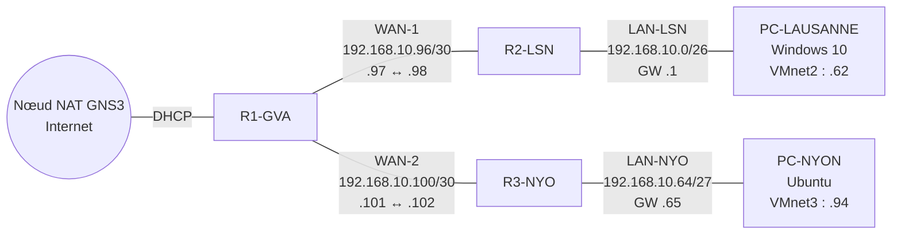

# TP Final ICND1 — Mission d'Ingénieur Réseau
 
A. Réseaux LAN et WAN (1 – 10)

1. LAN (Local Area Network) — réseau couvrant une zone géographique restreinte (bureau, bâtiment, campus).
Caractéristiques : infrastructure détenue et administrée par l'organisation ; débits élevés (1 Gbit/s à 10 Gbit/s et plus) ; faible latence, technologie dominante Ethernet (IEEE 802.3) et Wi-Fi.

2. WAN (Wide Area Network) — réseau reliant des LAN sur une grande distance (villes, pays).
Caractéristiques : infrastructure généralement louée à un opérateur (FAI/opérateur télécom) ; débits plus faibles et plus coûteux que le LAN ; latence plus élevée, technologies variées (fibre, MPLS, 4G/5G, DSL…).

3. Comparatif LAN / MAN / WAN

Critère	LAN	MAN	WAN
Étendue	Bâtiment / campus	Ville / agglomération	Région, pays, monde
Propriétaire	L'organisation	Collectivité / opérateur	Opérateurs télécom
Débit typique	1–100 Gbit/s	100 Mbit/s – 10 Gbit/s	Quelques Mbit/s à plusieurs Gbit/s (coût élevé)

4. WLAN — LAN sans fil (Wireless LAN), régi par la famille IEEE 802.11 (Wi-Fi : 802.11a/b/g/n/ac/ax…).

5. Technologies WAN actuelles (3 parmi) : fibre optique (FTTH/FTTB), MPLS, SD-WAN, VPN IPsec sur Internet, 4G/5G, DSL/VDSL, liaisons louées, satellite.

6. Le routeur : il travaille en couche 3, sépare les domaines de diffusion, choisit le meilleur chemin entre réseaux IP différents et dispose d'interfaces adaptées au WAN. Un switch (couche 2) ne fait que commuter des trames dans un même réseau, il ne route pas entre réseaux.

7. IEEE 802.3 (Ethernet filaire).

8. Topologie physique = disposition réelle des équipements et des câbles. Topologie logique = chemin suivi par les données et la façon dont les équipements communiquent (ex. : câblage physique en étoile, mais fonctionnement logique en bus pour un hub).

9. Topologies physiques 
Topologie	Avantage
Étoile	Une panne de câble n'affecte qu'un poste, facile à dépanner
Bus	Peu de câble, simple et peu coûteux
Anneau	Accès au support ordonné, pas de collisions
Maillée (mesh)	Redondance, haute disponibilité
(Arbre / hybride)	Évolutive, hiérarchique

10. Internet = réseau public mondial de réseaux interconnectés. Intranet = réseau privé interne d'une organisation, accessible aux seuls employés. Extranet = partie de l'intranet ouverte à des partenaires externes autorisés (fournisseurs, clients). 
 
 B. Monodiffusion, multidiffusion et diffusion (11 – 20) 

11. Unicast — communication d'un émetteur vers un seul destinataire. Ex. : PC-LAUSANNE consulte www.admin.ch.

12. Broadcast — d'un émetteur vers tous les hôtes du domaine de diffusion. Ex. : requête ARP, DHCP Discover.

13. Multicast — d'un émetteur vers un groupe d'hôtes abonnés. Ex. : diffusion vidéo IPTV, protocoles de routage (OSPF : 224.0.0.5, EIGRP : 224.0.0.10).

14. FF:FF:FF:FF:FF:FF (48 bits à 1).

15. 224.0.0.0 → 239.255.255.255 (224.0.0.0/4) → Classe D.

16. 255.255.255.255 (diffusion limitée : jamais routée).

17. Diffusion vers tous les hôtes d'un réseau précis (partie hôte à 1). Pour 192.168.1.0/24 → 192.168.1.255.

18. Non, un routeur ne transmet pas les broadcasts par défaut. Conséquence : chaque interface de routeur délimite un domaine de diffusion → les routeurs segmentent les domaines de diffusion (ce que ne font pas les switchs, sauf VLAN).

19. Requête ARP = broadcast (MAC destination FF:FF:FF:FF:FF:FF). Réponse ARP = unicast (directement vers le demandeur).

20. Le broadcast n'existe plus en IPv6. Il est remplacé par le multicast (ex. : FF02::1 all-nodes, adresses solicited-node utilisées par NDP, qui remplace ARP).
 
 C. Le modèle OSI (21 – 35)

21. 1 Physique — 2 Liaison de données — 3 Réseau — 4 Transport — 5 Session — 6 Présentation — 7 Application.
Moyen mnémotechnique (1→7) : « Pour Le Réseau Tout Se Passe Automatiquement ».

22. Physique — transmet les bits sous forme de signaux (électriques, lumineux, radio) ; définit connecteurs, tensions, débits. Éléments : câbles (cuivre, fibre), connecteurs RJ45, hubs, répéteurs, cartes réseau (partie physique).

23. Liaison de données — organise les bits en trames, gère l'adressage physique (MAC), l'accès au support et la détection d'erreurs (FCS). Sous-couches : LLC (Logical Link Control, IEEE 802.2 — dialogue avec la couche 3) et MAC (Media Access Control — accès au support, adressage).

24. Réseau — adressage logique (IP) et routage des paquets entre réseaux différents (choix du chemin). Équipement : routeur.

25. Transport — communication de bout en bout entre applications : segmentation, multiplexage par ports, contrôle de flux, fiabilité (TCP) ou rapidité (UDP).

26. Session — ouvre, maintient, synchronise et ferme les sessions de dialogue entre applications (points de reprise).

27. Présentation — format des données : codage, chiffrement, compression. Exemples : ASCII/UTF-8, JPEG/PNG, MPEG, TLS/SSL (chiffrement).

28. Application — interface entre les applications de l'utilisateur et le réseau. Protocoles : HTTP/HTTPS, DNS, DHCP, SMTP, FTP, SSH, Telnet.

29. PDU

Couche	PDU
1	Bits
2	Trame
3	Paquet
4	Segment (TCP) / Datagramme (UDP)
5-7	Données
30. Encapsulation (émission, couche 7 → 1) : chaque couche ajoute son en-tête (et la couche 2 une queue FCS) aux données de la couche supérieure. Décapsulation (réception, couche 1 → 7) : chaque couche lit et retire son en-tête puis transmet le reste à la couche supérieure.

31. Hub → 1 ; Switch → 2 ; Routeur → 3 ; Point d'accès Wi-Fi → 2 (et 1) ; Pare-feu applicatif → 7.

32. Adresse MAC : 48 bits (6 octets), notée en hexadécimal (ex. 00:50:56:C0:00:02). Les 24 premiers bits = OUI (constructeur).

33. Adresse IP : 32 bits en IPv4, 128 bits en IPv6.

34. Avantages : standardisation / interopérabilité entre constructeurs ; modularité (une couche peut évoluer sans changer les autres) ; dépannage facilité (méthode couche par couche) ; pédagogie, vocabulaire commun.

35. Trame Ethernet II : Préambule (7 o) + SFD (1 o) | MAC destination (6 o) | MAC source (6 o) | Type/EtherType (2 o, ex. 0x0800 = IPv4) | Données (46–1500 o) | FCS (4 o).
Le FCS (Frame Check Sequence) contient un CRC-32 : le récepteur recalcule le CRC, si différent la trame est corrompue et rejetée.
 
D. Le modèle TCP/IP (36 – 45)

36. Accès réseau — Internet — Transport — Application.

37. Correspondance

OSI	TCP/IP
7 Application, 6 Présentation, 5 Session	Application
4 Transport	Transport
3 Réseau	Internet
2 Liaison, 1 Physique	Accès réseau
38. OSI est un modèle de référence théorique (normatif, conçu avant les protocoles). TCP/IP est un modèle protocolaire pratique, décrit à partir des protocoles réellement utilisés sur Internet.

39. TCP vs UDP

Critère	TCP	UDP
Connexion	Orienté connexion (handshake)	Sans connexion
Fiabilité	Accusés de réception, retransmission	Aucune garantie
Ordre	Remise ordonnée (n° de séquence)	Pas d'ordre garanti
Contrôle de flux	Oui (fenêtrage)	Non
En-tête / vitesse	20 octets min., plus lent	8 octets, plus rapide
Usages	HTTP(S), SSH, FTP, SMTP	DNS, DHCP, VoIP, streaming, TFTP

40. Three-way handshake
Client → Serveur : SYN (seq = x)
Serveur → Client : SYN-ACK (seq = y, ack = x+1)
Client → Serveur : ACK (ack = y+1) → connexion établie.

41. Un port (16 bits, 0–65535) identifie l'application / le service sur un hôte.
Ports réservés (well-known) : 0 – 1023
Ports enregistrés : 1024 – 49151
Ports dynamiques / privés : 49152 – 65535
42. Socket = combinaison adresse IP + protocole + port (ex. 192.168.10.10:52344). Une connexion TCP est identifiée par la paire de sockets source/destination.

43. TTL (Time To Live) — compteur décrémenté de 1 par chaque routeur ; à 0, le paquet est détruit et un ICMP Time Exceeded est renvoyé → évite les boucles infinies. Commande : tracert (Windows) / traceroute (Linux, Cisco).

44. ICMP — messages de contrôle et d'erreur de la couche 3 (destination injoignable, TTL dépassé, echo). Commandes : ping et tracert/traceroute.

45. ARP — résout une adresse IPv4 en adresse MAC dans le réseau local. Commande Windows : arp -a.D. Le modèle TCP/IP (36 – 45)
36. Accès réseau — Internet — Transport — Application.

E. Protocoles et ports (46 – 55)
N°	Protocole	Port(s)	Transport

46. Telnet	23	TCP

47. SSH	22	TCP

48. HTTP / HTTPS	80 / 443	TCP (HTTP/3 : UDP 443)

49. DNS	53	UDP (requêtes) et TCP (transferts de zone, réponses > 512 o)

50. DHCP	67 (serveur) / 68 (client)	UDP

51. FTP	21 (contrôle/commandes) / 20 (données, mode actif)	TCP

52. SMTP / POP3 / IMAP	25 (587 soumission, 465 SMTPS) / 110 (995 POP3S) / 143 (993 IMAPS)	TCP

53. SNMP / Syslog / NTP	161 (162 traps) / 514 / 123	UDP

54. RDP	3389	TCP (et UDP)

50. Processus DORA Discover : le client cherche un serveur (broadcast).
Offer : le serveur propose une adresse.
Request : le client demande officiellement l'adresse proposée (broadcast, pour informer tous les serveurs).
Acknowledgment : le serveur confirme le bail.
55. Nom → IP : DNS. IP → MAC : ARP.
 
F. Adressage IPv4 (56 – 65)

56. 32 bits = 4 octets notés en décimal pointé. Le masque sépare la partie réseau (bits à 1 du masque) de la partie hôte (bits à 0).

57. Classe	1ᵉʳ octet	Masque par défaut
A	1 – 126 (127 = loopback)	255.0.0.0 (/8)
B	128 – 191	255.255.0.0 (/16)
C	192 – 223	255.255.255.0 (/24)

58. RFC 1918 : 10.0.0.0/8 — 172.16.0.0/12 (172.16 → 172.31) — 192.168.0.0/16.

59. Loopback : 127.0.0.1 (127.0.0.0/8). APIPA : 169.254.0.0/16 — attribuée automatiquement par le poste quand il est en DHCP et ne reçoit aucune réponse d'un serveur DHCP.

60. 192.168.10.100 → 11000000.10101000.00001010.01100100
(100 = 64 + 32 + 4 → 0110 0100)

61. 11000000.10101000.00000001.11111110 → 192.168.1.254

62. /27 → 255.255.255.224 (3 bits à 1 dans le 4ᵉ octet : 128+64+32). 255.255.255.240 → /28 (24 + 4).

63. Passerelle par défaut — adresse du routeur local à qui le poste envoie tout paquet destiné à un réseau différent du sien. Sans elle : communication limitée au réseau local.

64. Adresse publique : unique, routable sur Internet, attribuée par un FAI/RIR. Adresse privée (RFC 1918) : réutilisable dans chaque organisation, non routable sur Internet. Le NAT est nécessaire pour traduire les adresses privées en adresse publique afin d'accéder à Internet (et pallier la pénurie d'IPv4).

65. Wildcard = inverse du masque (bits à 0 = « doit correspondre », bits à 1 = « peu importe »). Utilisé dans les ACL et OSPF.
/26 = 255.255.255.192 → wildcard = 255.255.255.255 − 255.255.255.192 = 0.0.0.63.
 
G. Calcul de sous-réseaux (66 – 80)

66. /24 → /26 : 2 bits empruntés → 2² = 4 sous-réseaux ; 6 bits hôtes → 2⁶ − 2 = 62 hôtes par sous-réseau.

67. 172.16.35.123/20 — masque 255.255.240.0 → octet intéressant = 3ᵉ, magique = 256 − 240 = 16. Multiples : 0, 16, 32, 48… → 35 est dans le bloc 32.

Réseau	1ʳᵉ utilisable	Dernière utilisable	Broadcast
172.16.32.0	172.16.32.1	172.16.47.254	172.16.47.255
68. 10.10.10.200/27 — magique = 32 → multiples …160, 192, 224 → bloc 192.

Réseau	1ʳᵉ	Dernière	Broadcast
10.10.10.192	10.10.10.193	10.10.10.222	10.10.10.223
69. 192.168.50.77/29 — magique = 8 → …64, 72, 80 → bloc 72.

Réseau	1ʳᵉ	Dernière	Broadcast
192.168.50.72	192.168.50.73	192.168.50.78	192.168.50.79
70. /30 → 2² − 2 = 2 hôtes → liaisons point-à-point entre deux routeurs (exactement le cas de WAN-1 et WAN-2).

71. 500 hôtes → il faut h bits tels que 2ʰ − 2 ≥ 500 → 2⁸ − 2 = 254 (insuffisant), 2⁹ − 2 = 510 → 9 bits hôtes → /23 = 255.255.254.0.

72. 12 sous-réseaux → 2ⁿ ≥ 12 → n = 4 (16 sous-réseaux) → /24 + 4 = /28 (255.255.255.240) → 4 bits hôtes → 14 hôtes par sous-réseau.

73. /27 → blocs de 32 : .64 → .95. Oui, elles sont dans le même sous-réseau 192.168.10.64/27. Mais .95 est l'adresse de broadcast de ce sous-réseau : elle n'est pas attribuable à un hôte.

74. /26 → blocs de 64 : 0 → 63. .63 est le broadcast de 192.168.10.0/26 → Non, non attribuable.

75. 2ⁿ (n = bits empruntés à la partie hôte) = nombre de sous-réseaux. 2ʰ − 2 (h = bits restants pour les hôtes) = nombre d'hôtes utilisables (on retire l'adresse réseau et l'adresse de broadcast).

76. VLSM (Variable Length Subnet Mask) — utiliser des masques de longueurs différentes dans un même plan, pour adapter chaque sous-réseau au besoin réel → évite le gaspillage d'adresses (ex. /30 pour un lien point-à-point au lieu d'un /24).

77. VLSM de 192.168.20.0/24 (toujours du plus grand au plus petit besoin)

Segment	Besoin	Masque	Réseau	1ʳᵉ – dernière	Broadcast
LAN 100	2⁷−2 = 126	/25 (255.255.255.128)	192.168.20.0	.1 – .126	.127
LAN 50	2⁶−2 = 62	/26 (255.255.255.192)	192.168.20.128	.129 – .190	.191
LAN 20	2⁵−2 = 30	/27 (255.255.255.224)	192.168.20.192	.193 – .222	.223
P2P 1	2	/30 (255.255.255.252)	192.168.20.224	.225 – .226	.227
P2P 2	2	/30 (255.255.255.252)	192.168.20.228	.229 – .230	.231
Reste libre : 192.168.20.232 → .255.

78. Résumé de route

Réseau	3ᵉ octet en binaire
192.168.16.0	0001 0000
192.168.17.0	0001 0001
192.168.18.0	0001 0010
192.168.19.0	0001 0011
Bits communs : 16 (2 premiers octets) + 6 → /22 → route résumée 192.168.16.0/22 (255.255.252.0).

79. /22 → 32 − 22 = 10 bits hôtes → 2¹⁰ − 2 = 1 022 hôtes.

80. /28 → blocs de 16 : 1ᵉʳ = .0, 2ᵉ = .16, 3ᵉ = .32, 4ᵉ = .48, 5ᵉ = .64 → réseau 192.168.1.64/28, broadcast 192.168.1.79.
 
 H. Configuration de base d'un routeur Cisco (81 – 87)
 
81. Modes IOS

Mode	Invite	Commande d'accès
EXEC utilisateur	Router>	(connexion console/VTY)
EXEC privilégié	Router#	enable
Configuration globale	Router(config)#	configure terminal
Configuration d'interface	Router(config-if)#	interface g0/0
(Autres sous-modes : (config-line)# via line console 0 / line vty 0 4.)

82. Router(config)# hostname R1-GVA
R1-GVA(config)# banner motd # Acces reserve au personnel autorise #
Le caractère # est le délimiteur de la bannière (il ne doit pas apparaître dans le texte).

83. enable password stocke le mot de passe en clair (ou faiblement chiffré type 7). enable secret le stocke sous forme de hachage (MD5 type 5, ou type 8/9 sur IOS récents) → non réversible. Si les deux existent, enable secret est prioritaire.

84. service password-encryption chiffre tous les mots de passe en clair de la configuration (console, VTY, enable password) en type 7. Limite : le type 7 est un chiffrement faible et réversible (décodable en quelques secondes) → il protège seulement contre la lecture par-dessus l'épaule.

85. running-config = configuration active en RAM (perdue au redémarrage). startup-config = configuration enregistrée en NVRAM, chargée au démarrage. Sauvegarde : copy running-config startup-config (ou write memory / wr).

86. R1-GVA(config)# interface g0/1
R1-GVA(config-if)# ip address 192.168.10.97 255.255.255.252
R1-GVA(config-if)# no shutdown
Les interfaces de routeur Cisco sont désactivées par défaut (administratively down) → no shutdown est obligatoire.

87. show ip interface brief : résumé IP + état (Status/Protocol) de chaque interface.
show running-config : configuration active complète.
show ip route : table de routage (réseaux connus, origine, prochain saut).
 
I. Accès distant : Telnet et SSH (88 – 92)

88. Les lignes VTY (Virtual TeleType) sont les lignes virtuelles utilisées pour l'administration à distance (Telnet/SSH). Par défaut, 5 lignes : vty 0 4 (certains IOS/plateformes en proposent 16 : 0 à 15).

89. Prérequis SSH, Un nom d'hôte différent de Router (hostname).Un nom de domaine (ip domain-name).Une paire de clés RSA (crypto key generate rsa).Une authentification locale : utilisateur (username … secret …) + login local sur les VTY.
(Implicites : une image IOS avec crypto « k9 » et une IP joignable.)

90. Telnet transmet tout en clair (identifiants, mots de passe, commandes). Dans Wireshark (Follow TCP Stream), on lit le mot de passe caractère par caractère et toutes les commandes tapées. Vulnérable à l'écoute (sniffing) et au vol de session.

91. R2-LSN(config)# line vty 0 4
R2-LSN(config-line)# transport input ssh

92. SSH v1 : failles connues (attaque d'insertion CRC-32, intégrité faible), obsolète. SSH v2 : échange de clés Diffie-Hellman, intégrité par HMAC, algorithmes plus robustes, normalisé (RFC 4251-4254). Sur Cisco IOS, SSH v2 exige une clé RSA d'au moins 768 bits ; recommandation actuelle : 2048 bits minimum. 
 
J. Routage statique (93 – 96)

93. Syntaxe

ip route <réseau_destination> <masque> {<next-hop> | <interface_sortie>} [distance_administrative]
Next-hop : on indique l'IP du routeur voisin → le routeur fait une recherche récursive pour trouver l'interface de sortie. Recommandé sur Ethernet.
Interface de sortie : la route apparaît comme directement connectée ; sur Ethernet (multi-accès), le routeur doit faire un ARP pour chaque destination (proxy ARP) → à éviter seul sur Ethernet. On peut combiner les deux (route entièrement spécifiée).

94. Route par défaut — route utilisée quand aucune route plus précise ne correspond (« passerelle de dernier recours »).

ip route 0.0.0.0 0.0.0.0 <next-hop | interface>

95. Route connectée : AD = 0. Route statique : AD = 1. Route statique flottante = route statique de secours configurée avec une AD supérieure à celle de la route principale (ex. ip route 0.0.0.0 0.0.0.0 10.0.0.2 5) → elle n'entre dans la table que si la route principale disparaît.

96. Code	Signification
C	Réseau directement connecté
L	Adresse locale de l'interface (/32)
S	Route statique
S*	Route statique par défaut (candidate default)
	
K. NAT (97 – 100)

97. NAT statique : correspondance fixe 1 ↔ 1 entre une IP privée et une IP publique (ex. serveur accessible depuis Internet).
NAT dynamique : correspondance 1 ↔ 1 temporaire puisée dans un pool d'adresses publiques.
PAT / NAT overload : plusieurs adresses privées ↔ une seule IP publique, différenciées par les numéros de port (cas d'une box Internet, cas du TP).

98. Terme	Définition	Exemple du TP
Inside local	IP privée de l'hôte interne, vue de l'intérieur	192.168.10.10 (PC-LAUSANNE)
Inside global	IP de l'hôte interne après traduction, vue de l'extérieur	IP de R1 Gi0/0 (ex. 192.168.122.x)
Outside local	IP de l'hôte externe vue depuis l'intérieur	8.8.8.8
Outside global	IP réelle de l'hôte externe	8.8.8.8
99. PAT avec surcharge

interface g0/0
 ip nat outside
interface g0/1
 ip nat inside
access-list 1 permit 192.168.10.0 0.0.0.255
ip nat inside source list 1 interface g0/0 overload

100. show ip nat translations : table des traductions actives.
show ip nat statistics : interfaces inside/outside, compteurs hits/misses, ACL utilisée.
clear ip nat translation * : vide la table (tests).
debug ip nat : affiche chaque traduction en temps réel (undebug all pour arrêter).
show access-lists : vérifie que l'ACL NAT est bien « matchée ».	
 
 
 
# CDC 1 — Dossier d'architecture

---

## 1.1 — LAN et WAN : qualification de l'infrastructure

**Critères utilisés :** étendue géographique, propriété de l'infrastructure, équipements en jeu, et nature du lien.

| Segment | Type | Justification |
|---|---|---|
| **LAN-LSN** (PC-LAUSANNE) | **LAN** | Réseau local limité au site de Lausanne, administré par Léman Logistique, relié par un commutateur (VMnet2 dans le labo). Débit élevé, adressage privé. |
| **LAN-NYO** (PC-NYON) | **LAN** | Même logique pour le site de Nyon (VMnet3 dans le labo). |
| **WAN-1** (R1-GVA ↔ R2-LSN) | **WAN** | Lien point-à-point entre deux sites géographiquement distants (Genève et Lausanne). Il relie des routeurs et, en production, passerait par un opérateur. |
| **WAN-2** (R1-GVA ↔ R3-NYO) | **WAN** | Même logique entre Genève et Nyon. |
| **R1-GVA ↔ nœud NAT** | **WAN** (accès Internet) | Sortie vers un réseau externe qui n'appartient pas à l'entreprise ; l'adresse est obtenue en DHCP et traduite par NAT. |

**Remarque :** dans GNS3, les liens WAN sont simulés par de simples liens Ethernet. Ils restent des WAN sur le plan conceptuel, car ils interconnectent des sites distincts via des routeurs.

---

## 1.2 — Unicast, broadcast ou multicast

| Flux | Type | Justification |
|---|---|---|
| **(a)** Un PC demande une adresse par DHCP | **Broadcast** | Le DHCP Discover part sans que le client ait d'IP ni connaisse le serveur : IP source `0.0.0.0`, IP destination `255.255.255.255`, MAC destination `FF:FF:FF:FF:FF:FF`. Tous les hôtes du segment reçoivent la trame, mais seul le serveur DHCP y répond. |
| **(b)** PC-LAUSANNE consulte un site web | **Unicast** | Communication un-à-un entre le PC et le serveur web, destinée à une seule adresse IP (le DNS, en amont, est lui aussi en unicast). |
| **(c)** Diffusion vidéo interne vers tous les entrepôts | **Multicast** | Une source, plusieurs destinataires, mais uniquement ceux qui se sont abonnés au groupe (adresse `224.0.0.0/4`, abonnement via IGMP). Un broadcast serait inadapté : il ne franchit pas les routeurs et sollicite tous les hôtes, même ceux qui n'en ont pas besoin. Un unicast obligerait à envoyer N copies du flux. |
| **(d)** Un PC cherche la MAC de sa passerelle | **Broadcast** (requête ARP) | Le PC connaît l'IP de la passerelle mais pas sa MAC : la requête ARP est envoyée à `FF:FF:FF:FF:FF:FF`. La réponse ARP, elle, est en **unicast**. |

---

## 1.3 — Tableau comparatif OSI / TCP-IP

| N° OSI | Couche OSI | Couche TCP/IP | Rôle | PDU | Protocole (exemple) | Équipement de Léman Logistique |
|---|---|---|---|---|---|---|
| 7 | Application | Application | Fournit aux applications l'accès au réseau | Données | HTTP/HTTPS, DNS, DHCP, SSH, Telnet | PC-LAUSANNE / PC-NYON (navigateur, client SSH) ; routeurs (serveur SSH/Telnet, client DHCP sur R1-GVA) |
| 6 | Présentation | Application | Format des données, chiffrement, compression | Données | TLS, chiffrement de session SSH, ASCII | PC (navigateur en HTTPS) ; routeurs (SSH v2) |
| 5 | Session | Application | Ouvre, maintient et ferme les dialogues | Données | Sessions SSH/Telnet sur les lignes vty | Routeurs R1, R2, R3 (accès à distance) |
| 4 | Transport | Transport | Communication de bout en bout, ports, fiabilité | Segment (TCP) / Datagramme (UDP) | TCP, UDP | PC (ports source/destination) ; R1-GVA (NAT/PAT travaille sur les ports) |
| 3 | Réseau | Internet | Adressage logique et routage entre réseaux | Paquet | IP, ICMP (ping) | Routeurs R1-GVA, R2-LSN, R3-NYO |
| 2 | Liaison de données | Accès réseau | Adressage physique (MAC), accès au support, détection d'erreurs | Trame | Ethernet, ARP | Commutateur (VMnet), interfaces Ethernet des routeurs et des PC |
| 1 | Physique | Accès réseau | Transmission des bits sur le support | Bits | Signaux électriques/optiques, Ethernet (couche physique) | Câbles / liens GNS3, cartes réseau |

---

## 1.4 — Parcours d'un paquet de PC-LAUSANNE vers 8.8.8.8

**Hypothèses :** PC-LAUSANNE a l'adresse `192.168.10.x` dans LAN-LSN, sa passerelle est R2-LSN (`192.168.10.1`), et les routes par défaut sont en place (R2 → R1, R1 → nœud NAT). R1-GVA fait du NAT sur son interface Internet (DHCP).

### Étape 1 — Encapsulation sur PC-LAUSANNE

1. **Application :** génération des données (ex. une requête DNS ou un ping vers `8.8.8.8`).
2. **Transport :** ajout de l'en-tête UDP/TCP (ports source/destination) → segment ou datagramme.
3. **Réseau :** ajout de l'en-tête IP (source = IP du PC, destination = `8.8.8.8`) → paquet.
4. **Liaison :** `8.8.8.8` n'est pas dans le réseau local (comparaison avec le masque), donc la trame est adressée à la **passerelle**. Le PC obtient sa MAC par ARP (broadcast), puis construit la trame (MAC destination = R2, MAC source = PC).
5. **Physique :** envoi des bits.

### Étape 2 — Saut par saut

| Saut | MAC source | MAC destination | IP source | IP destination |
|---|---|---|---|---|
| PC-LAUSANNE → R2-LSN (g1/0) | MAC du PC | MAC de R2 (g1/0) | `192.168.10.x` | `8.8.8.8` |
| R2-LSN (g0/0) → R1-GVA (WAN-1) | MAC de R2 (g0/0) | MAC de R1 (côté WAN-1) | `192.168.10.x` | `8.8.8.8` |
| R1-GVA (g0/0) → nœud NAT GNS3 | MAC de R1 (g0/0) | MAC de la passerelle du nœud NAT | **adresse DHCP de R1 g0/0** (après NAT) | `8.8.8.8` |

### Points clés

- **Les adresses MAC changent à chaque saut.** Chaque routeur désencapsule la trame, consulte sa table de routage, puis la ré-encapsule avec les MAC du lien suivant.
- **Les adresses IP source et destination restent inchangées** de bout en bout, **sauf au passage du NAT** sur R1-GVA.
- **Avant NAT :** IP source = `192.168.10.x` (adresse privée du LAN-LSN).
- **Après NAT :** IP source = adresse obtenue en DHCP sur l'interface Internet de R1-GVA. Le nœud NAT de GNS3 fait ensuite sa propre traduction vers la machine hôte (double NAT).
- À chaque routeur, le **TTL est décrémenté de 1** et le checksum IP est recalculé.
- **Retour de la réponse :** le NAT de R1 retrouve la correspondance dans sa table de traduction et rétablit l'adresse `192.168.10.x` comme destination, puis la réponse suit le chemin inverse. 

# CDC 1 — Plan d'adressage VLSM

---

## 1. Besoins et règles

| Segment | Besoin |
|---|---|
| LAN-LSN (Lausanne) | 50 hôtes (croissance incluse) |
| LAN-NYO (Nyon) | 20 hôtes |
| WAN-1 (R1-GVA ↔ R2-LSN) | Point-à-point |
| WAN-2 (R1-GVA ↔ R3-NYO) | Point-à-point |

**Règles imposées :**
- Découpage dans l'ordre décroissant des besoins, à partir de `192.168.10.0`.
- Passerelle d'un LAN = **première** adresse utilisable.
- Adaptateur hôte VMware (VMnet) = **dernière** adresse utilisable du LAN.
- Sur les WAN, R1-GVA prend la **première** adresse utilisable.

---

## 2. Détail des calculs

Formule : nombre d'hôtes utilisables = 2ⁿ − 2 (n = bits d'hôte), masque = /(32 − n).

### 2.1 LAN-LSN : 50 hôtes
- n = 5 → 2⁵ − 2 = 30 < 50 
- n = 6 → 2⁶ − 2 = **62 ≥ 50** 
- Préfixe : 32 − 6 = **/26** → masque `255.255.255.192` (256 − 64 = 192)
- Taille du bloc : **64 adresses**
- Marge : 62 − 50 = 12 adresses pour la croissance (la passerelle et le VMnet y tiennent : 50 + 2 = 52 ≤ 62).

### 2.2 LAN-NYO : 20 hôtes
- n = 4 → 2⁴ − 2 = 14 < 20 
- n = 5 → 2⁵ − 2 = **30 ≥ 20** 
- Préfixe : 32 − 5 = **/27** → masque `255.255.255.224` (256 − 32 = 224)
- Taille du bloc : **32 adresses**

### 2.3 WAN-1 et WAN-2 : 2 hôtes chacun
- n = 2 → 2² − 2 = **2 ≥ 2** 
- Préfixe : 32 − 2 = **/30** → masque `255.255.255.252` (256 − 4 = 252)
- Taille du bloc : **4 adresses**

### 2.4 Placement (ordre décroissant)

| Ordre | Segment | Début | Fin | Alignement |
|---|---|---|---|---|
| 1 | LAN-LSN (64) | `.0` | `.63` | 0 est multiple de 64 |
| 2 | LAN-NYO (32) | `.64` | `.95` | 64 est multiple de 32 |
| 3 | WAN-1 (4) | `.96` | `.99` | 96 est multiple de 4 |
| 4 | WAN-2 (4) | `.100` | `.103` | 100 est multiple de 4 |

---

## 3. Tableau récapitulatif

| Segment | Réseau | Masque décimal | CIDR | 1ʳᵉ utilisable | Dernière utilisable | Broadcast | Nb d'hôtes |
|---|---|---|---|---|---|---|---|
| **LAN-LSN** | `192.168.10.0` | `255.255.255.192` | `/26` | `192.168.10.1` | `192.168.10.62` | `192.168.10.63` | 62 |
| **LAN-NYO** | `192.168.10.64` | `255.255.255.224` | `/27` | `192.168.10.65` | `192.168.10.94` | `192.168.10.95` | 30 |
| **WAN-1** | `192.168.10.96` | `255.255.255.252` | `/30` | `192.168.10.97` | `192.168.10.98` | `192.168.10.99` | 2 |
| **WAN-2** | `192.168.10.100` | `255.255.255.252` | `/30` | `192.168.10.101` | `192.168.10.102` | `192.168.10.103` | 2 |

---

## 4. Attribution des adresses

| Équipement / interface | Adresse IP | Masque | Rôle |
|---|---|---|---|
| R2-LSN g1/0 | `192.168.10.1` | `255.255.255.192` | Passerelle LAN-LSN (1ʳᵉ utilisable) |
| Adaptateur VMnet2 (hôte VMware) | `192.168.10.62` | `255.255.255.192` | Dernière utilisable LAN-LSN |
| R3-NYO (interface LAN) | `192.168.10.65` | `255.255.255.224` | Passerelle LAN-NYO (1ʳᵉ utilisable) |
| Adaptateur VMnet3 (hôte VMware) | `192.168.10.94` | `255.255.255.224` | Dernière utilisable LAN-NYO |
| R1-GVA (interface WAN-1) | `192.168.10.97` | `255.255.255.252` | 1ʳᵉ utilisable WAN-1 |
| R2-LSN g0/0 | `192.168.10.98` | `255.255.255.252` | WAN-1 |
| R1-GVA (interface WAN-2) | `192.168.10.101` | `255.255.255.252` | 1ʳᵉ utilisable WAN-2 |
| R3-NYO (interface WAN-2) | `192.168.10.102` | `255.255.255.252` | WAN-2 |
| PC-LAUSANNE | `192.168.10.x` (entre `.2` et `.61`) | `255.255.255.192` | Passerelle `192.168.10.1` |
| PC-NYON | `192.168.10.y` (entre `.66` et `.93`) | `255.255.255.224` | Passerelle `192.168.10.65` |

---

## 5. Vérifications

- **Aucun chevauchement :** les plages `.0–63`, `.64–95`, `.96–99` et `.100–103` sont contiguës et disjointes.
- **Pas de gaspillage injustifié :** seules les marges de croissance des LAN restent libres (12 adresses à Lausanne, 10 à Nyon) ; les WAN utilisent des /30 stricts.
- **Tout reste dans le bloc imposé :** les adresses de `192.168.10.0` à `192.168.10.103` sont utilisées.
- **Espace restant :** `192.168.10.104` → `192.168.10.255` (152 adresses), disponible pour de futurs segments.

---

## 6. Schéma réseau

CDC 2 — Mise en service et sécurisation des accès
Etape 1 : Nom de l'hote et interface 

Etape 2 : configuration de base sécurisé

Etape 3 : Demonstration telnet et ssh 

CDC 3 — Routage statique, NAT et intégration GNS3 ↔ VMware 

