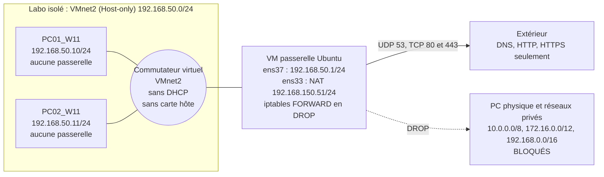

# Projet 3 — Réseau virtuel isolé (labo de test)

## 1. Objectif

Créer un labo de test isolé d'Internet et du réseau physique : deux VM Windows 11 sur un réseau virtuel interne, puis une VM passerelle Ubuntu qui filtre le trafic et n'autorise que le strict nécessaire vers l'extérieur.

## 2. Schéma du réseau

**Annotations :**

1. **Réseau interne** : `VMnet2` est en mode Host-only, avec la carte virtuelle côté hôte décochée. Le PC physique n'est pas connecté au labo.
2. **Pas de DHCP** : les adresses sont fixes, aucune distribution automatique.
3. **Pas de passerelle par défaut** sur PC01 et PC02 : aucune route vers Internet ni vers le réseau physique.
4. **Point d'accès unique** : la VM passerelle. Les VM du labo ne l'utilisent que si une route vers `192.168.50.1` est ajoutée volontairement.
5. **Filtrage** : la passerelle bloque tout par défaut et n'autorise que le DNS, HTTP et HTTPS vers l'extérieur.

## 3. Plan d'adressage

| Machine | Interface | Réseau | Adresse IP | Masque | Passerelle |
|---|---|---|---|---|---|
| PC01_W11 | Ethernet0 | VMnet2 | `192.168.50.10` | `255.255.255.0` | aucune |
| PC02_W11 | Ethernet0 | VMnet2 | `192.168.50.11` | `255.255.255.0` | aucune |
| VM passerelle Ubuntu | `ens37` | VMnet2 (côté labo) | `192.168.50.1` | `255.255.255.0` | aucune |
| VM passerelle Ubuntu | `ens33` | NAT (côté extérieur) | `192.168.150.51` | `255.255.255.0` | passerelle NAT VMware |

## 4. Étape 1 : créer le réseau virtuel interne

Je crée le réseau `VMnet2` en mode Host-only, sans DHCP et sans carte virtuelle côté hôte.

## 5. Étape 2 : connecter les deux VM

PC01_W11 et PC02_W11 sont reliées à `VMnet2`, avec une IP fixe et sans passerelle.

## 6. Étape 3 : vérifier l'isolation

Sans passerelle, les VM ne joignent ni Internet ni le PC physique.

## 7. Étape 4 : VM passerelle avec filtrage

La VM Ubuntu a une carte côté labo (`ens37`) et une carte NAT côté extérieur (`ens33`). Le filtrage est fait avec `iptables`.

### 7.1 Règles d'isolation appliquées

| # | Règle | Où | Effet |
|---|---|---|---|
| 1 | Réseau de type **Host-only** (`VMnet2`) | Virtual Network Editor | Réseau interne uniquement |
| 2 | Carte virtuelle hôte **décochée** | VMnet2 | Le PC physique n'a aucun lien avec le labo |
| 3 | Service DHCP **désactivé** | VMnet2 | Adresses fixes, aucune distribution automatique |
| 4 | **Aucune passerelle par défaut** | IP de PC01 et PC02 | Aucune route vers Internet ni vers le réseau physique |
| 5 | **Aucune carte NAT ou Bridged** | Paramètres des VM du labo | Aucun lien extérieur direct |
| 6 | Politique `FORWARD` en **DROP** | VM passerelle | Tout est interdit sauf ce qui est explicitement autorisé |
| 7 | Blocage des **réseaux privés** | VM passerelle | Le réseau physique reste inaccessible, même via la passerelle |
| 8 | Seuls **DNS, HTTP et HTTPS** autorisés | VM passerelle | Accès extérieur limité au strict nécessaire |
| 9 | **ICMP non autorisé** vers l'extérieur | VM passerelle | Pas de ping vers Internet |

### 7.2 Règles de filtrage de la passerelle

| Règle `iptables` | Effet |
|---|---|
| `-P FORWARD DROP` | Politique par défaut : tout est bloqué |
| `-A FORWARD -i ens37 -d 10.0.0.0/8 -j DROP` | Blocage du réseau privé `10.0.0.0/8` |
| `-A FORWARD -i ens37 -d 172.16.0.0/12 -j DROP` | Blocage du réseau privé `172.16.0.0/12` |
| `-A FORWARD -i ens37 -d 192.168.0.0/16 -j DROP` | Blocage du réseau privé `192.168.0.0/16` |
| `-A FORWARD -i ens37 -o ens33 -p udp --dport 53 -j ACCEPT` | DNS autorisé |
| `-A FORWARD -i ens37 -o ens33 -p tcp -m multiport --dports 80,443 -j ACCEPT` | HTTP et HTTPS autorisés |
| `-A FORWARD -i ens33 -o ens37 -m state --state ESTABLISHED,RELATED -j ACCEPT` | Retour des réponses uniquement |
| `-t nat -A POSTROUTING -o ens33 -j MASQUERADE` | Traduction d'adresses vers l'extérieur |

L'ordre compte : les règles `DROP` des réseaux privés sont placées **avant** les règles `ACCEPT`, pour qu'aucun flux vers le réseau physique ne soit autorisé par erreur.

L'ordre compte : les règles `DROP` des réseaux privés sont placées avant les règles `ACCEPT`, pour qu'aucun flux vers le réseau physique ne soit autorisé par erreur.

## 8. Test et résultat

Ping entre les deux VM du labo :

| Test | Résultat attendu | Résultat observé | Preuve |
|---|---|---|---|
| PC01 ↔ PC02 : ping dans les deux sens | Réponse | Réponse | Partie 5 |
| PC01 et PC02 : `ping 8.8.8.8` sans passerelle | Échec | Échec | Partie 3.2 |
| PC01 et PC02 : `ping google.com` sans passerelle | Échec | Échec | Partie 3.3 |
| PC01 et PC02 : ping du PC physique sans passerelle | Échec | Échec | Partie 3.3 |
| PC01 : `ping 192.168.50.1` (passerelle) | Réponse | Réponse | Partie 4.3 |
| PC01 avec route : `curl http://example.com` | Fonctionne | Fonctionne | Partie 4.5 |
| PC01 avec route : `ping 8.8.8.8` | Échec (ICMP bloqué) | Échec | Partie 4.5 |
| PC01 avec route : ping d'un réseau privé | Échec (DROP) | Échec | Partie 4.5 |

## 9. Limites et améliorations

- La passerelle reste joignable depuis le labo (c'est voulu : elle sert de point d'accès), mais elle ne transmet rien vers les réseaux privés.
- Un utilisateur du labo qui connaît l'adresse de la passerelle peut s'en servir pour accéder au web. Un filtrage par adresse source permettrait de réserver cet accès à certaines VM.
- Les règles `iptables` saisies en ligne de commande sont perdues au redémarrage si elles ne sont pas enregistrées (par exemple avec `iptables-persistent`).
- Pour un labo plus strict, on peut supprimer la carte NAT de la passerelle et ne laisser aucun accès extérieur.

## 10. Conclusion

Le labo est isolé : les deux VM communiquent entre elles mais n'ont aucun accès direct à Internet ni au réseau physique. La VM passerelle est le seul point de sortie, et elle n'autorise que le DNS, HTTP et HTTPS en bloquant tous les réseaux privés.
